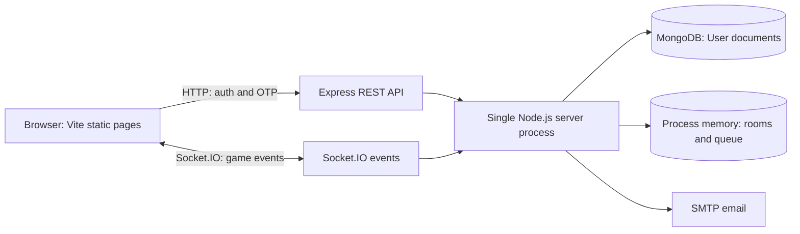

# Keyz Dice Game — Master Project Brain

**Document purpose:** durable, implementation-grounded guide for new developers and maintainers. It records what the checked-in source currently does, what appears intended but is not connected or fails, known risks, and recommended next decisions. It is not a product specification or a guarantee that the current application runs end-to-end.

**Review date:** 2026-10-30  
**Evidence standard:** runtime claims below are traced from source, not inferred from filenames or older prose. “Intended” and “recommendation” are explicitly labeled. No secrets are reproduced.

## 1. Executive summary

### Technical explanation

Keyz Dice Game is an early-stage browser multiplayer dice game. Its intended users are two people with accounts who play a shared, turn-based dice game using virtual balances, a pot, bets, and a loan pool. Values are displayed using `R`, but the application has no payment processor, deposit, withdrawal, cash-out, or real-money ledger. Treat the values as game credits unless product owners define otherwise.

The system is a small, split frontend/backend application with a modular-monolith server:

- The client is a vanilla JavaScript, two-page Vite app: account forms in [client/index.html](client/index.html) and the game screen in [client/app.html](client/app.html). The active game controller is [client/src/main.js](client/src/main.js).
- The backend is a single Node.js process running Express and Socket.IO from [server/server.js](server/server.js). Express exposes registration, login, and OTP routes; Socket.IO handles live game interactions.
- MongoDB/Mongoose stores user accounts and a user balance field. Live rooms, matchmaking state, pots, loans, and game state are held in process memory by [server/services/roomManager.js](server/services/roomManager.js).
- The server generates dice using Node’s `crypto.randomInt` through [server/services/gameService.js](server/services/gameService.js). The browser displays the result; it is not the authority for game outcomes.

**Maturity:** prototype / incomplete MVP. The repository has an end-to-end concept and substantial implementation, but important cross-layer contracts are broken. The account verification path is not reliable, the client’s room link does not select the server room, and reconnecting players are not given active game event handlers. A dependable public multiplayer experience is therefore not established by source inspection.

**Production status:** not production-ready. In addition to functional gaps, the database connection string is printed in logs by [server/config/database.js](server/config/database.js); match stake deductions are not transactional as a pair; room state and game history are not durable; the active server swallows balance-persistence errors; there are no meaningful automated tests; and no deployment/operations pipeline is present in the repository. The workspace reports a prior `node server.js` exit code of 1, but the diagnostic output and environment values were not available, so the cause is unknown.

**Business objective (inferred):** offer a lightweight social dice-game experience with shared virtual stakes and bank/loan mechanics. No authoritative product specification, acceptance criteria, monetization plan, or roadmap is present.

**Technical objective (evidenced):** authenticate account holders, pair two connected players, enforce turns and game actions on the server, update shared state, and persist user account data.

**Value status:** the code demonstrates the core design and useful building blocks, but the value proposition is not yet reliably delivered end-to-end due to the concrete integration defects in Section 6. The README’s feature list is not proof that each feature is operational; compare [README.md](README.md) with the actual contracts below.

### Explain like I am 12

This is meant to be a website where two signed-in people play a dice game together. The server is the referee: it rolls the real dice, decides whose turn it is, and tells both browsers the score. The accounts are saved in a database, but the live game table exists only in the server’s memory. Right now, some important doors between signup, room links, and game reconnection do not line up, so the game still needs repairs before people can depend on it.

## 2. End-to-end user flow

This section distinguishes the **intended user journey** from the **observed implementation**. A flow in source is not necessarily a successful flow in a running deployment.

### 2.1 Registration and email verification

1. The user opens the login/signup page. [client/src/authscreen.js](client/src/authscreen.js) toggles the login and signup panels. Signup submits email and password from [client/src/js/signup.js](client/src/js/signup.js) to `POST /api/auth/register` using `VITE_API_URL`.
2. The server applies Express validation in [server/routes/authRoutes.js](server/routes/authRoutes.js): email format and password length of at least eight characters, one uppercase letter, and one digit. [server/controllers/authController.js](server/controllers/authController.js) normalizes email, hashes the password with bcryptjs cost 12, and creates a MongoDB user with `isVerified: false`.
3. During registration the controller generates a six-digit OTP with `Math.random()` and assigns `otp` and `otpExpires` on the user. It then attempts to email the code. These OTP fields are not declared in [server/models/user.js](server/models/user.js). With Mongoose’s default strict schema behavior, do not assume these extra fields are persisted.
4. After the registration request succeeds, the browser separately calls `POST /api/otp/send-otp`. [server/controllers/otpController.js](server/controllers/otpController.js) delegates to [server/services/otpService.js](server/services/otpService.js), which looks up the user, assigns another OTP to undeclared fields, saves, and emails a code. This creates a second send attempt and does not fix the schema mismatch.
5. Login is blocked while `isVerified` is false. Verification is also broken: the OTP controller’s verification handler references `jwt.sign()` without importing `jsonwebtoken`. Even if OTP storage were fixed and the user were marked verified, the handler reaches a `ReferenceError` after saving the verified status and returns a server error. The client in [client/src/js/verifyotp.js](client/src/js/verifyotp.js) expects `data.verified`, but the controller returns a message and token, not a `verified` property; it also does not store the returned token.

**Practical consequence:** new account creation may succeed while email delivery fails, and verification cannot be relied on to complete. If an email send fails after the user document has been created, the user record remains even though the signup request reports failure. This needs a designed recovery flow, not only a client-side message change.

### 2.2 Login and socket authentication

1. The user submits the login form; [client/src/js/login.js](client/src/js/login.js) calls `POST /api/auth/login`.
2. The controller normalizes email, checks the password hash, rejects unverified accounts, and signs a seven-day JWT containing the user ID and email.
3. The client stores the token in `localStorage` and navigates to `app.html`.
4. [client/src/main.js](client/src/main.js) reads that token and opens a Socket.IO connection to `VITE_API_URL`, passing the JWT in handshake auth. [server/middleware/socketAuth.js](server/middleware/socketAuth.js) verifies the token, reloads the account from MongoDB, and requires `isVerified` before attaching user identity to the socket.

The HTTP auth middleware in [server/middleware/auth.js](server/middleware/auth.js) exists but is not applied to the current REST routes. Registration/login are public by necessity; socket actions are protected by socket authentication. The token is stored in browser local storage, so any successful same-origin script injection could read it.

### 2.3 Finding a match and entering a room

1. The game page reads a `room` query parameter or creates a random room-like string and writes `?room=...` to browser history.
2. On each Socket.IO `connect`, the client emits `find-match` with a fixed stake of R100. The URL’s room value is **not sent** to the server.
3. The active server keeps one module-local `waitingPlayer` slot in [server/sockets/gameSocket.js](server/sockets/gameSocket.js). A first player waits. A second player must choose exactly the same stake. The server accepts stakes from R20 to R10,000, loads both user balances, atomically deducts each stake separately from MongoDB, creates a generated room ID, assigns player1/player2, joins both sockets to the Socket.IO room, and broadcasts state.
4. `match-found` gives the generated room ID and role to the client. The client then emits `join-room`, but **the active server has no `join-room` listener**. This extra event is unnecessary for the current server because it already joined both sockets internally.
5. The client rewrites the URL as `?${roomId}`, not `?room=${roomId}`. The displayed/copyable room URL therefore will not restore the expected `room` parameter on reload. More importantly, matchmaking ignores the URL ID and always generates a new server room. Room links are not an implemented invite/join mechanism.

### 2.4 Playing a round

1. On fresh matchmaking, the client uses the role supplied by `match-found`. The server does not emit `player-role` in this path; it emits that event only in its reconnect branch.
2. The player clicks Roll. The client performs a convenience turn check and emits `roll-dice` with the room ID.
3. The server checks room ID format, its per-socket roll rate limit, seat ownership (socket ID, stored seat, email), and whose turn it is. It calls `processRoll()` and broadcasts `dice-result` and `game-state`.
4. When a round ends, the server credits the pot to the winner’s in-memory room balance, clears the pot and stake counters, resets the point phase, starts the next round with the other role, emits `round-winner`, and starts asynchronous balance persistence.
5. Players can send `place-bet` or `request-loan`. Bets debit only in-memory room balance and increase the pot. Loans debit the room loan pool and credit the in-memory balance. Neither operation has a durable transaction record.

### 2.5 Disconnect and reconnect

The active disconnect handler removes a disconnected waiting socket from matchmaking and clears its rate-limit entries. It does not emit `player-disconnected`, release a room seat, or expire the room.

On a new connection whose email already has a seat in a live in-memory room, the server updates that seat to the new socket ID, joins the new socket to the room, emits `player-role`, broadcasts state, and then returns from the connection callback. Because event listeners for `roll-dice`, `place-bet`, and `request-loan` are registered after this early return, the reconnected socket does not receive those action handlers. The prior socket is not forcibly disconnected or removed from the Socket.IO room, though it no longer matches the seat’s stored socket ID and cannot pass seat ownership checks. Reconnection is therefore incomplete.

## 3. Architecture and active source map

### Runtime topology

### Server startup

[server/server.js](server/server.js) loads dotenv, requires `MONGO_URI`, `JWT_SECRET` of at least 32 characters, and `CLIENT_URL`, creates Express/HTTP/Socket.IO, enables Helmet, CORS, JSON parsing, and process-local HTTP rate limits, mounts routes, installs socket authentication and the active game socket handler, connects MongoDB, then listens. The default port in source is 10000 (overridable by `PORT`). The top-level `/` route is a simple liveness response. The checked-in server entry is `server.js`; package scripts use it.

The database connection helper [server/config/database.js](server/config/database.js) itself logs the complete `MONGO_URI`. Do not run this in a shared environment with credential-bearing connection strings until fixed; rotate any credentials that may already have reached logs.

### Active client and server modules

- Client page/build setup: [client/vite.config.js](client/vite.config.js), [client/package.json](client/package.json), [client/index.html](client/index.html), [client/app.html](client/app.html).
- Auth UI and HTTP requests: [client/src/authscreen.js](client/src/authscreen.js), [client/src/js/login.js](client/src/js/login.js), [client/src/js/signup.js](client/src/js/signup.js), [client/src/js/verifyotp.js](client/src/js/verifyotp.js).
- Game UI and socket protocol: [client/src/main.js](client/src/main.js), [client/src/js/app/state.js](client/src/js/app/state.js), [client/src/js/app/ui.js](client/src/js/app/ui.js), [client/src/js/routes/roll.js](client/src/js/routes/roll.js).
- Server entry/config: [server/server.js](server/server.js), [server/config/database.js](server/config/database.js), [server/middleware/socketAuth.js](server/middleware/socketAuth.js).
- Auth/persistence: [server/routes/authRoutes.js](server/routes/authRoutes.js), [server/routes/otpRoutes.js](server/routes/otpRoutes.js), [server/controllers/authController.js](server/controllers/authController.js), [server/controllers/otpController.js](server/controllers/otpController.js), [server/models/user.js](server/models/user.js).
- Active game: [server/sockets/gameSocket.js](server/sockets/gameSocket.js), [server/services/roomManager.js](server/services/roomManager.js), [server/services/gameService.js](server/services/gameService.js), [server/services/bankService.js](server/services/bankService.js), [server/sockets/socketHandler/loanHandler.js](server/sockets/socketHandler/loanHandler.js), [server/sockets/socketHandler/roleHelpers.js](server/sockets/socketHandler/roleHelpers.js), [server/utils/broadcastGameState.js](server/utils/broadcastGameState.js).

There are also helper modules that are not wired into the active entry path: [server/config/socket.js](server/config/socket.js), most files in [server/sockets/socketHandler](server/sockets/socketHandler), and [server/services/authService.js](server/services/authService.js). Client-side bank/side-bet helpers and route placeholders are not imported by the active game controller: [client/src/js/app/bank.js](client/src/js/app/bank.js), [client/src/js/routes/sidebet.js](client/src/js/routes/sidebet.js), [client/src/js/routes/placebet.js](client/src/js/routes/placebet.js), [client/src/js/routes/taxchoice.js](client/src/js/routes/taxchoice.js), and [client/src/js/app/dice.js](client/src/js/app/dice.js). The `reconnectHandler..js` file is explicitly labeled dead. Presence in the repository does not mean a module executes.

### Active HTTP contract

| Method and route | Purpose | Important current behavior |
|---|---|---|
| `GET /` | Liveness | Returns a simple server-running message; does not check database health after startup. |
| `POST /api/auth/register` | Create account | Validation middleware plus controller; account is created unverified and email is attempted. |
| `POST /api/auth/login` | Authenticate | Requires verified user; returns seven-day JWT. |
| `POST /api/otp/send-otp` | Send code | Basic email check, calls the OTP service. |
| `POST /api/otp/verify-otp` | Verify code | Marks account verified before reaching missing `jwt` reference; response path is broken. |

### Active Socket.IO contract

| Direction | Event | Data/purpose |
|---|---|---|
| Client → server | `find-match` | `{ stake }`; one-slot queue, exact matching stakes. |
| Server → client | `waiting` | Wait status. |
| Server → client | `match-found` | `{ roomId, role }`; server-created room. |
| Client → server | `join-room` | Client emits after match; no active handler exists. |
| Client → server | `roll-dice` | `{ roomId }`; server validates and rolls. |
| Server → room | `dice-result` | Dice, sum, roller, message, point-phase fields. |
| Client → server | `place-bet` | `{ roomId, amount, player }`; server validates seat and amount. |
| Server → room | `bet-placed` | Bet amount, pot, balances. |
| Client → server | `request-loan` | `{ roomId, amount }`; server grants from room pool when allowed. |
| Server → client/room | `loan-granted`, `round-winner`, `game-state` | Confirmation and current state. |
| Server → client | `player-role`, `error`, `room-full` | `player-role` is used in reconnect flow; `room-full` is listened for but not emitted by active flow. |

The active server does not emit `game-start` or `player-disconnected`, despite those names appearing in older documentation/client listeners. `game-state` is assembled by [server/utils/broadcastGameState.js](server/utils/broadcastGameState.js) and includes turn, phase, point, pot, stake values, `balances`, and `loanPool`.

## 4. Rules and data model

### Dice and turn rules as coded

Two dice are generated as `crypto.randomInt(1, 7)`. In the first-roll phase: a total of 7 or 11 wins for the current roller; 2, 3, or 12 loses for the roller; otherwise that total becomes the point and the turn passes to the other player. In the point phase: rolling the point wins for the roller; rolling 7 loses for the roller; any other total passes the turn to the other player. After a round ends, the winner is paid, state resets, and the next round’s first roller is the other role from the winner.

This is a craps-inspired custom two-player ruleset. It is not the standard casino craps shooter model: the code alternates players after a point is set. Confirm intended rules with product ownership before changing behavior.

### Credits, wagers, and loans

- New `User` records have a MongoDB `balance` default of 1000. Room creation also initializes both role balances to 1000, but matchmaking then loads each account balance and overwrites those room defaults. If balance loading fails, the helper falls back to 1000.
- Match stakes are R20–R10,000 and must exactly match. The browser always sends R100. Each is deducted with an individual atomic MongoDB update before the room is created; the two deductions are not one transaction.
- Additional bets must be finite values from R20 to R10,000 and fit the in-memory balance. Fractional values are not explicitly rejected. Bets can be placed at any time, not only in a specified phase/turn. They are added to the room pot and `roundContributions`, but no bet ledger is stored.
- Loans are accepted by the active server from R1 to R500 per role per room, limited cumulatively to R500 and by available shared pool. The UI imposes a minimum of R20. The active loan handler does not implement a contribution-based borrowing limit or event rate limit.
- On round completion, the whole pot is credited to the winning room balance. The server writes both resulting balances to MongoDB asynchronously. `persistBalances()` subtracts cumulative `loansIssued` from each room balance on every call, but the loan totals are not reset or repaid into the pool. This risks inconsistent/repeated deductions across rounds. Persistence errors are caught and logged rather than making settlement fail visibly.

### Rules that exist in code but are not active

[server/services/bankService.js](server/services/bankService.js) defines streak and total-win tax rules plus another loan function, but the active game socket only imports `applyBankRules` and never calls it. The active path does not update `bank.winStreak`, `bank.totalWins`, or `bank.last3Bets`; `roundContributions` is updated but is not used by that tax logic. Consequently, the documented taxes and bank-service loan contribution limits are not active gameplay behavior. The client bank module is also not wired to the active server game.

[server/models/gameResult.js](server/models/gameResult.js) defines a result schema and indexes, but active gameplay never creates a `GameResult`; match history is not saved. Contrary to one older note, the current schema uses valid `String` field types.

### Data placement and restart effects

| Data | Current location | Survives server restart? |
|---|---|---|
| User email, password hash, verified flag, account balance | MongoDB | Yes, subject to database availability and successful writes |
| JWT | Browser local storage | Until removed/expired; seven-day expiry |
| Matchmaking waiter | Server process memory | No |
| Room, seats, current turn, pot, loans, bank state | Server process memory | No |
| OTP | Attempted on Mongoose user object, but schema fields absent; behavior unreliable | Not reliably |
| Round/game history | No active persistence path | No |

The architecture is single-process. Multiple server replicas would have independent queues and room maps unless distributed state, socket adapters, and settlement coordination are introduced.

## 5. Design decisions, objectives, and constraints

### Evidence-backed decisions

- **Server-authoritative game:** the browser requests actions and animates; the server computes rolls and controls turn/state.
- **Small modular monolith:** one Node server owns HTTP and realtime concerns; there is no microservice boundary.
- **Two-seat rooms:** only player1/player2 are modeled; no spectator, host, or moderation role exists.
- **Account store separated from live game:** MongoDB owns account documents; game room state is in memory. The database balance is updated at round settlement, and stake deduction occurs at match start.
- **Virtual-credit presentation:** code displays `R` units but contains no payment rail or cash settlement.

### Constraints and limitations

- Process-local queue, rate limits, OTP handling attempts, and rooms prevent reliable horizontal scaling and durable recovery.
- A server restart can discard active rooms after user stakes were already deducted.
- Pairwise stake deduction is not transactional; if player two’s deduction fails after player one’s succeeds, no refund is implemented.
- A player can request another match while already seated; the same account can potentially be matched against itself. These cases are not blocked in `find-match`.
- A disconnected seat has no expiration or settlement policy.
- Client local storage is the token store; client-side checks are usability only and cannot replace server validation.
- The room ID injected into the game-page HTML comes from a URL parameter and is interpolated into `innerHTML`, creating a client-side HTML/script injection risk for a logged-in visitor.
- Most feedback uses alerts, console output, or free-form strings; the client/server event payload contract has no shared schema or protocol version.
- UI and server expectations differ: on fresh match the role is set in state but the UI’s `player-role` setup handler does not run; both visible player bet/loan controls can remain enabled, though the client action functions still compare against the chosen role.

## 6. Code-review findings and risk register

Severity is based on impact to the current prototype, not on a formal risk model. Reproduce in a safe test environment before acting on persistence/account data.

### Critical / high priority

1. **Database credential exposure in logs.** [server/config/database.js](server/config/database.js) prints the entire connection URI. Remove this and rotate any credentials that could have been captured in logs.
2. **OTP/account verification path is broken.** `User` has no OTP fields, the OTP handler references an unimported `jwt`, and client response expectations do not match. Login and socket auth both require `isVerified`, making this a blocking account onboarding problem.
3. **Room invite/rejoin links do not work as represented.** Client query IDs are not passed into matchmaking; the server creates unrelated IDs; the client’s post-match URL is malformed. The `join-room` client event is not served.
4. **Reconnect returns before game action handlers are registered.** A reconnected socket can receive role/state but its roll/bet/loan actions have no active listeners. The old socket is not removed/disconnected.
5. **URL-derived HTML injection risk.** The room query string is inserted into a template assigned to `#app.innerHTML`. Render untrusted values as text or use DOM APIs.
6. **Money-like credits are not settled durably/atomically.** Pairwise stake deductions can strand one user’s stake; room state disappears on restart; end-of-round balance writes are independent, asynchronous, absolute-value writes whose failures are swallowed; no durable escrow/ledger or refund path exists. Do not use for real-money play.

### Medium priority

7. **Matchmaking lacks lifecycle/identity guards.** No active-room check in `find-match`, no self-match prevention, one global waiting slot, no waiter timeout, and no transaction around opponent matching.
8. **Loan accounting is inconsistent.** Loan debt is in memory; no repayment-to-pool exists; cumulative debt is subtracted from user balance on each settlement call without resetting debt.
9. **Feature claims differ from active behavior.** Tax functions are never invoked; last-three-bet and win counters are never updated; `GameResult` is not written; `game-start`/`player-disconnected` are not emitted. README and the making-of guide should be treated as descriptive material, not source of truth.
10. **Client reconnect can repeat matchmaking.** Every socket `connect` emits `find-match`; the server’s existing-room branch then returns before registering the handlers, so automatic client reconnect is not a recovery path.
11. **Client event handling assumes complete game state.** The game-state handler has optional guards and then unconditionally reads `state.balances` and `state.loanPool`; a partial payload throws and can leave the UI stale.
12. **No active loan/bet phase or turn restriction.** The server checks seat and amount, but allows bets at any time and does not constrain loans to a game phase. Confirm intended rules.
13. **OTP security/abuse controls are insufficient.** OTP generation uses `Math.random()`, there is no per-code attempt counter/lock, and process-level HTTP rate limits are not a full account/IP abuse strategy.

### Lower priority / maintenance

14. **Dead or staged implementation copies.** `config/socket.js`, `socketHandler` helpers, client side-bet/bank helpers and stubs coexist with the active implementations. `reconnectHandler..js` explicitly identifies itself as dead. Remove or integrate modules deliberately to avoid misleading maintainers.
15. **No meaningful automated quality gates.** The server `npm test` command is intentionally a failing placeholder; client package only provides dev/build/preview scripts. There is no lint/type-check/test workflow or CI configuration.
16. **Deployment configuration is unverified.** Server requires environment configuration; client API URL must point to the deployed server and CORS must match the browser origin. The local `.env` was not read because it is excluded/secret-bearing. The prior startup exit code cannot be diagnosed from available output.
17. **UI/accessibility polish is incomplete.** Forms provide limited state/error handling; the auth CSS disables body scrolling, which may clip content on short screens; Google Fonts are a third-party runtime dependency.

## 7. Production readiness and future direction

### Current readiness assessment

| Area | Assessment | Evidence/impact |
|---|---|---|
| Product definition | Incomplete | No authoritative rules/acceptance criteria; R display has unclear product meaning. |
| Account onboarding | Not reliable | OTP schema/handler/client mismatches block verified login. |
| Game rules | Partially implemented | Dice path is server-side; tax and side-bet features are inactive. |
| Realtime flow | Prototype | Initial matchmaking code exists; invite URLs and reconnect actions do not work. |
| Data integrity | Not production-safe | In-memory game state, non-transactional two-player stake handling, weak recovery. |
| Security | Has material gaps | URI credential logging, XSS risk, local-storage token exposure, incomplete abuse controls. |
| Scalability | Single process only | Global queue and room map are process-local. |
| Observability/operations | Minimal | Console output and root liveness only; no metrics, alerting, readiness, or runbook. |
| QA | Not established | No automated tests; server test script fails by design. |
| Deployment | Not demonstrated | No CI/CD, deployment manifests, or verified production configuration in repository. |

**Conclusion:** suitable for local experimentation after environment setup and fixes; not suitable for public production use or any real-money settlement.

### Recommended direction (not a committed roadmap)

1. **Define the product boundary first.** Confirm free virtual credits vs. any monetary value, locales/currency display, exact dice rules, betting phases, loan semantics, and room lifecycle. If real money is contemplated, stop feature work for a legal/compliance/security architecture review.
2. **Remove immediate security exposure.** Stop logging `MONGO_URI`; rotate exposed credentials; eliminate the query-to-`innerHTML` path; review token transport/storage and production TLS.
3. **Repair onboarding as one coherent flow.** Add explicit OTP schema/storage (prefer hashed OTP with expiry/attempt limits), use a cryptographic generator, make verification atomic/idempotent, import/use JWT correctly, align API response with client, and test email failure/retry cases.
4. **Specify and repair matchmaking.** Decide whether users join an invite room or a matchmaking queue. Implement one authoritative protocol, add duplicate-seat/self-match checks, queue timeout/cancel, room expiry, and failure refunds.
5. **Make reconnect a first-class path.** Register the same authorized handlers after reconnect, replace/disconnect stale socket, notify peers, set grace period, and define abandoned-round settlement.
6. **Protect balances with durable accounting.** Decide whether the user balance is an account wallet or an in-room starting allocation. Use durable match/escrow/ledger records and database transactions for paired stakes and settlement; never rely on best-effort writes for credits.
7. **Clarify game rules and remove misleading code.** Either wire and test bank/tax/side-bet rules with server authority or remove claims/modules. Save game results if history is a product requirement.
8. **Add tests before expanding features.** Unit tests for each dice outcome/turn, accounting invariants, loans, reconnect, validation, and concurrency; integration tests for auth/OTP and socket matchmaking; then build/deployment smoke tests.
9. **Prepare operations and scale deliberately.** Add structured logs without secrets, health/readiness endpoints, error monitoring, backups, environment templates containing placeholders only, deployment automation, and—only when needed—shared matchmaking/Socket.IO state (e.g. Redis plus a compatible adapter) and durable room recovery.

## 8. Onboarding and verification notes for maintainers

### Repository layout

- [client](client): Vite application, source, static dice images, lockfile.
- [server](server): Express/Socket.IO application, Mongoose models, services, lockfile.
- [README.md](README.md): brief product/stack introduction; contains an unfilled demo link and should not be used as complete setup documentation.
- [THE_MAKING_OF_KEYZ_DICE_GAME.md](THE_MAKING_OF_KEYZ_DICE_GAME.md): long educational narrative. It contains useful context but also stale/inaccurate descriptions; verify every behavior against active source.
- [MASTER_PROJECT_BRAIN.md](MASTER_PROJECT_BRAIN.md): this source-grounded reference.

### Package commands and environment

Run package scripts from their respective package directories; there is no root package manifest.

- Client: `npm run dev`, `npm run build`, `npm run preview` in `client/`.
- Server: `npm start` or `npm run dev` in `server/`; both execute `node server.js`. Server startup requires `MONGO_URI`, `JWT_SECRET` (minimum 32 characters), and `CLIENT_URL`; `PORT` is optional and defaults to 10000. SMTP also needs `EMAIL_USER` and `EMAIL_PASS` for OTP mail delivery.
- Client: `VITE_API_URL` must be set at build/dev time to the server origin. Values prefixed `VITE_` become browser-visible; never put secrets in them.
- Use a supported modern Node version. The Vite lockfile indicates a Vite toolchain requirement of Node `^20.19.0 || >=22.12.0`.

No tests or runtime verification were performed as part of this document update. The existing server test script is a placeholder failure, not a test result. The reported previous server exit with code 1 remains unexplained without its error output and the required environment context.

### Evidence boundary and maintenance policy

Reviewed authored application source, HTML/CSS, package manifests and lockfile metadata, configuration, and the existing project documents; source images were reviewed as presentation assets. Environment files and secret values were not opened or copied. Installed dependency internals, generated/minified build output, Git internals, and the bundled MongoDB executable/cache were not treated as application source. When source changes, update the active contracts, flow, data-lifecycle table, and risk register here; keep claims labeled as observed, intended, or proposed.

---

**Project brain status:** source-grounded baseline; no source-code remediation included. Prioritize security and core flow fixes before treating this as a user-ready game.